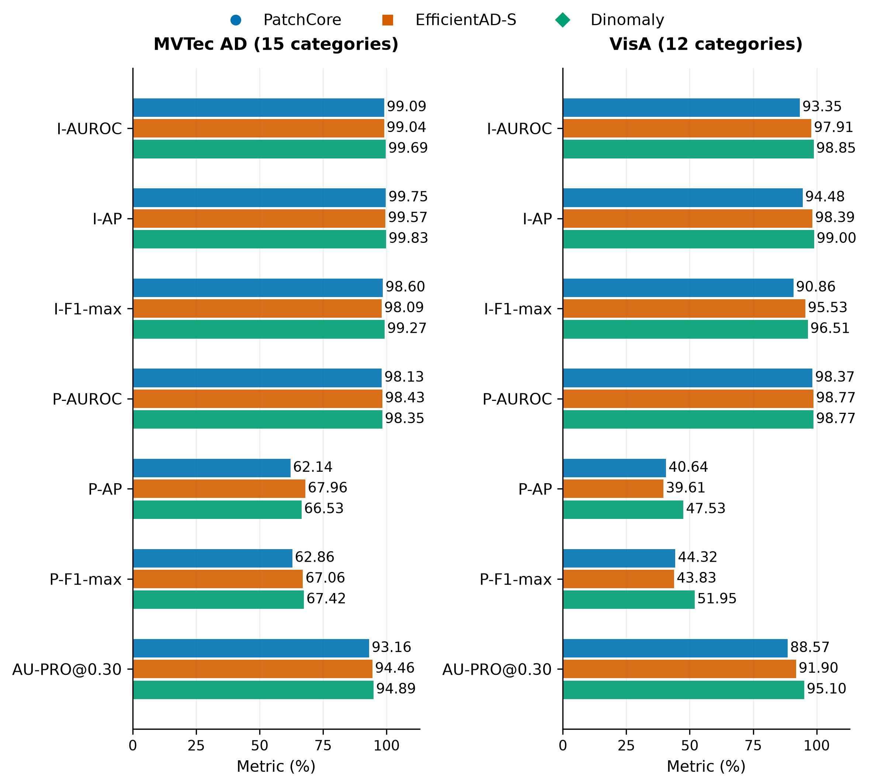
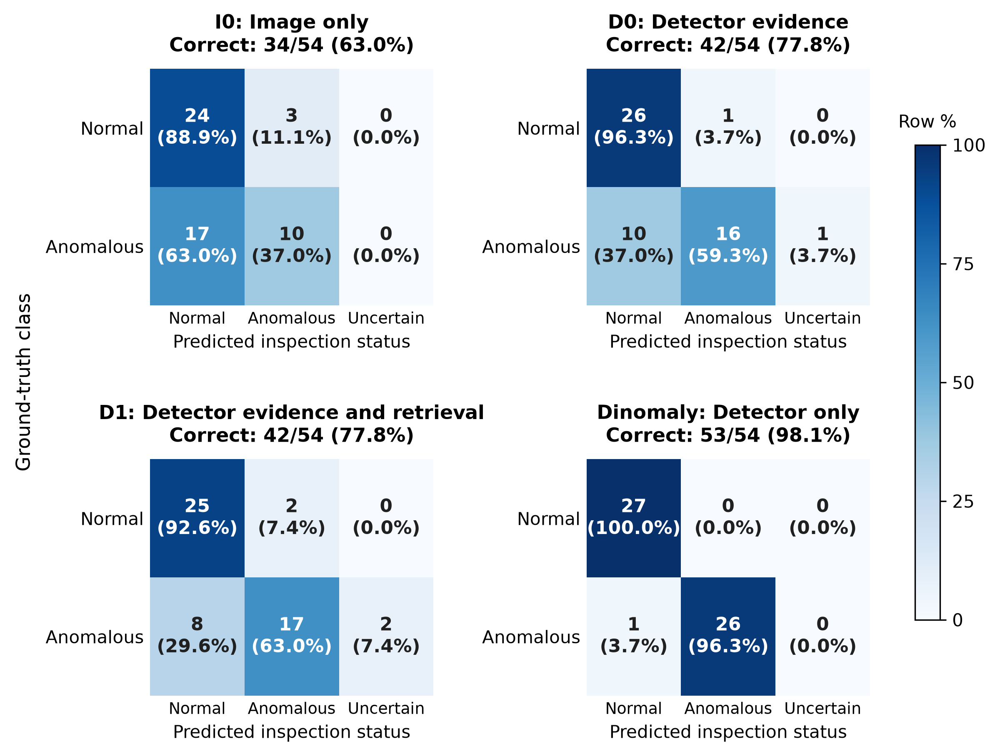

<h1 align="center">DINOv2-Based Industrial Anomaly Detection<br>with Vision-Language-Model-Generated Quality Control Reports</h1>

<p align="center">
  <b>Mehmet Övgü Hun</b><br>
  MSc thesis in Data Science<br>
  University of Debrecen, Faculty of Informatics<br>
  2026
</p>

---

> **Abstract.** This repository holds the code and the results of the thesis.
> The thesis compares Dinomaly, a detector built on the frozen DINOv2 image
> encoder, with PatchCore and EfficientAD-S on 3,887 test images from MVTec AD
> and VisA. It then studies 162 structured quality-control reports that a
> frozen, quantised Qwen2.5-VL-3B-Instruct wrote for 54 test images under
> three conditions: the image alone, the image with detector evidence, and the
> same with a retrieved knowledge card. Detector evidence raised the number of
> reports with a correct inspection status from 34 to 42 of 54, while the
> detector alone was correct on 53. Retrieval left the number at 42.

## Contents

1. [Overview](#1-overview)
2. [Results](#2-results)
3. [Repository layout](#3-repository-layout)
4. [Installation](#4-installation)
5. [Quick check](#5-quick-check)
6. [Data and weights](#6-data-and-weights)
7. [Reproducing the experiments](#7-reproducing-the-experiments)
8. [Reproducibility](#8-reproducibility)
9. [Licences](#9-licences)
10. [Citation](#10-citation)

## 1. Overview

Qwen writes a structured inspection report for each of 54 test images, one
normal and one anomalous from each of the 27 categories, in three conditions:

| Condition | Input to Qwen |
| --- | --- |
| I0: image | the test image |
| D0: + detector | the image with Dinomaly's score, cutoff and prediction, and an overlay of its anomaly map when the prediction is anomalous |
| D1: + knowledge card | D0 with a knowledge card about the product category, when E5-small-v2 retrieves that category's own card |

### 1.1 Research questions

As stated in the thesis (VLM: vision-language model).

**RQ1.** How does anomaly detection based on patch features from the frozen
pretrained image encoder DINOv2 (implemented via Dinomaly) perform in terms of
image-level classification and pixel-level localisation when compared to
PatchCore and EfficientAD-S on the MVTec AD and VisA datasets?

**RQ2.** When a VLM is tasked with generating quality control reports about
inspected products, how does providing anomaly scores and anomaly-map
visualisations from a DINOv2-based anomaly detector affect the correctness of
the resulting reports and their evidence consistency in comparison to using
product images alone?

**RQ3.** When generating inspection reports conditioned on information from an
anomaly detector, how does supplementing the VLM with potentially relevant
information retrieved from a curated defect knowledge base affect the
correctness of the resulting reports and the share of reports that contain
unsupported or incorrect statements?

### 1.2 Key findings

- **Detectors.** Dinomaly has the highest mean image AUROC and AU-PRO on both
  datasets. Mean pixel AUROC differs by at most 0.4 points between the
  detectors.

- **Detector evidence (D0).** Correct normal/anomalous status rises from 34
  to 42 of 54 reports, and reports with a material error fall from 32 to 26.

- **Knowledge card (D1).** Correct status stays at 42 of 54. Useful reports
  go from 24 to 25, and reports with a material error from 26 to 28.

## 2. Results

Figures 1 and 2 show both studies at a glance; click a chart for its full size.

<table>
  <tr>
    <td width="50%" align="center" valign="middle"><a href="results/detector/dataset_means.png"></a></td>
    <td width="50%" align="center" valign="middle"><a href="results/reports/status_confusion_matrices.png"></a></td>
  </tr>
  <tr>
    <td align="center"><sub><b>Figure 1.</b> Detectors (RQ1). Mean over the product categories of each dataset, in per cent. I and P mark image-level and pixel-level metrics.</sub></td>
    <td align="center"><sub><b>Figure 2.</b> Reports (RQ2, RQ3). Report status against the image label on the same 54 images. Each cell gives the count and its share of the 27 images in that row; “uncertain” never counts as correct.</sub></td>
  </tr>
</table>

### 2.1 Anomaly detection (RQ1)

**Table 1.** Mean over the categories of each dataset, in per cent. The best
value per dataset is in bold.

| Detector | Dataset | Image AUROC | Pixel AUROC | AU-PRO |
| --- | --- | ---: | ---: | ---: |
| PatchCore | MVTec AD | 99.09 | 98.13 | 93.16 |
| EfficientAD-S | MVTec AD | 99.04 | **98.43** | 94.46 |
| Dinomaly | MVTec AD | **99.69** | 98.35 | **94.89** |
| PatchCore | VisA | 93.35 | 98.37 | 88.57 |
| EfficientAD-S | VisA | 97.91 | 98.77 | 91.90 |
| Dinomaly | VisA | **98.85** | 98.77 | **95.10** |

Notes on Table 1:

- On VisA, EfficientAD-S and Dinomaly both round to 98.77 in pixel AUROC, so
  neither value is in bold.

- Image metrics use each detector's own image score.

- Pixel metrics and AU-PRO (up to a false-positive rate of 0.3) are computed
  on a 256 x 256 grid over the image region that all three anomaly maps
  cover. They are therefore not comparable with the values in the detector
  papers.

- Per-category results, image and pixel AP and F1-max are in each detector's
  `metrics.csv` and `summary.csv` under
  [results/detector/](results/detector/).

- Charts for every category (image AUROC, AU-PRO, pixel AUROC and pixel AP):
  [MVTec AD](results/detector/comparison_mvtec_ad.png) and
  [VisA](results/detector/comparison_visa.png).

### 2.2 Inspection reports (RQ2, RQ3)

**Table 2.** Reports out of 54 per condition
([results/reports/](results/reports/)).

| | I0: image | D0: + detector | D1: + knowledge card |
| --- | ---: | ---: | ---: |
| Correct normal/anomalous status | 34/54 (63.0%) | 42/54 (77.8%) | 42/54 (77.8%) |
| Useful report | 21/54 (38.9%) | 24/54 (44.4%) | 25/54 (46.3%) |
| Report with a material error | 32/54 (59.3%) | 26/54 (48.1%) | 28/54 (51.9%) |

Notes on Table 2:

- **Detector alone.** Dinomaly's own prediction is anomalous when its score
  is above a per-category cutoff (the 0.98 quantile of its scores on the
  category's other normal test images). It is correct for 53 of the 54
  images.

- **Knowledge cards.** In D1, 24 of the 27 categories retrieved their own
  knowledge card. Fryum, macaroni1 and pcb1 retrieved another category's
  card, so their D1 reports got no card.

- **Grading.** Each report is graded against reference answers for its
  image. A material error is an explicit statement or recommendation that is
  contradicted or lacks necessary support. The grade is a yes or no per
  report and does not distinguish unsupported from contradicted statements.
  The share of reports with a material error is the second outcome named in
  RQ3.

- **Files.** [results/reports/README.md](results/reports/README.md)
  describes the grades, and `summary.csv` and `paired_changes.csv` there
  hold all measures.

## 3. Repository layout

```
.
├── scripts/        the eight pipeline steps, run in order (Section 7)
├── src/            modules the steps share: datasets, metrics, predictions, figures
├── configs/        reporting settings, the prompt and the report schema
├── knowledge/      the 27 knowledge cards, one per category, with sources
├── results/        the reported results
├── tests/          unit tests
├── third_party/    unmodified PatchCore, EfficientAD and Dinomaly code
└── licenses/       licence texts for other included code
```

## 4. Installation

Linux with Python 3.12 and an NVIDIA GPU that supports CUDA 13.0 and
bfloat16. The reported runs used an RTX 5070 Laptop GPU.

```bash
python3.12 -m venv .venv
source .venv/bin/activate
pip install -r requirements.txt
python -m unittest discover tests
```

Two of the tests read the datasets and are skipped until they are in place
(see [Section 6](#6-data-and-weights)).

## 5. Quick check

The report summaries can be reproduced in seconds, without data, weights or
a GPU:

```bash
mkdir -p outputs/reports
cp results/reports/{cases,reports,grades}.csv outputs/reports/
python -m scripts.08_evaluate_reports
cmp outputs/reports/summary.csv results/reports/summary.csv
cmp outputs/reports/paired_changes.csv results/reports/paired_changes.csv
```

`cmp` prints nothing when the files are identical. Delete `outputs/reports/`
afterwards: 07 does not overwrite an existing `reports.csv`, and 08 accepts a
grade only for the answer it was given for.

## 6. Data and weights

Extract the datasets so that these paths exist:

| Dataset | Path | Source |
| --- | --- | --- |
| MVTec AD (CC BY-NC-SA 4.0) | `data/MVTec-AD/<category>/` | [mvtec.com](https://www.mvtec.com/research-teaching/datasets/mvtec-ad) |
| VisA (CC BY 4.0) | `data/VisA/<category>/` | [VisA_20220922.tar](https://amazon-visual-anomaly.s3.us-west-2.amazonaws.com/VisA_20220922.tar) |
| VisA one-class split | `data/VisA/split_csv/1cls.csv` | in the VisA archive; also in [amazon-science/spot-diff](https://github.com/amazon-science/spot-diff/blob/2a692ab575001cbde74d402d897a7286086c6199/split_csv/1cls.csv) |
| Imagenette, full size (only for 02) | `data/imagenette2/train/` | [imagenette2.tgz](https://s3.amazonaws.com/fast-ai-imageclas/imagenette2.tgz) |

Then run `python -m unittest discover tests` again: the two dataset tests now
check both datasets' image counts against the official numbers.

Save the weights under these paths:

| Weights | Path | Source |
| --- | --- | --- |
| EfficientAD-S teacher | `weights/efficientad/teacher_small.pth` | [`models/teacher_small.pth`](https://github.com/nelson1425/EfficientAD/blob/fcab5146f84ae17597044ad5ddf1656ccf805401/models/teacher_small.pth) in nelson1425/EfficientAD |
| Dinomaly-B, MVTec AD | `weights/dinomaly/mvtec_vitb_it20k.pth` | MVTec-AD row of [Trained model weights](https://github.com/guojiajeremy/Dinomaly/blob/1f252be03a918789b19848f0ca37166e7c28dada/README.md#trained-model-weights) in the Dinomaly README |
| Dinomaly-B, VisA | `weights/dinomaly/visa_vitb_it20k.pth` | VisA row of the same table |

To check them, run this from the repository root:

```bash
sha256sum -c <<'EOF'
b98a6a139087a0d743783ee59f367f0284af6003eb1a5fed0ce92bd9c0acd337  weights/efficientad/teacher_small.pth
2108f25729b303938306ddafdf76e8275f8654b106f044b45e2a5bec9d29085c  weights/dinomaly/mvtec_vitb_it20k.pth
e5031cb3f69f9bea75fa429359295d1599b09eef87b684d601c91d1d71bc959e  weights/dinomaly/visa_vitb_it20k.pth
EOF
```

The other models download on first use: torchvision's WideResNet-50-2
(`IMAGENET1K_V1` weights) for PatchCore, and E5-small-v2 and
Qwen2.5-VL-3B-Instruct at the revisions in `configs/reporting.json`.

## 7. Reproducing the experiments

Run each script from the repository root as `python -m scripts.<name>`, for
example `python -m scripts.03_dinomaly`. For the full study, run all eight in
this order; for the reporting study alone, 03 and then 05 to 08 are enough.
Times refer to the RTX 5070 Laptop GPU.

| Script | What it does | Time |
| --- | --- | --- |
| `01_patchcore.py` | PatchCore scores and anomaly maps | about 1.5 h |
| `02_efficientad.py` | trains EfficientAD-S per category; scores and maps | about 48 h |
| `03_dinomaly.py` | Dinomaly scores and maps from the released checkpoints | about 5 min |
| `04_compare_detectors.py` | RQ1 metrics on the shared image region | about 10 min |
| `05_select_report_images.py` | the 54 report images and the per-category cutoffs | seconds |
| `06_retrieve_knowledge.py` | one knowledge card per category (CPU) | under a minute |
| `07_generate_reports.py` | the 162 reports with Qwen2.5-VL-3B-Instruct | about 9 min, plus loading the model |
| `08_evaluate_reports.py` | the RQ2 and RQ3 summaries from the grades | seconds |

02 trains the 27 categories one after another and cannot resume: if it stops,
the next run starts again from the first category.

05 draws the report images at random (seed 0) from the test images that are
not listed under `excluded_images` in `configs/reporting.json`. Those 117
images were used for trial runs while the prompt and the report settings were
prepared; leaving them out keeps the 54 report images separate from those
runs.

07 stops if `outputs/reports/reports.csv` already exists, so a finished run
is never overwritten. On its first run, 08 writes an empty grading sheet,
`outputs/reports/grades.csv`, and stops: grade the reports as described in
[results/reports/README.md](results/reports/README.md) and run it again.

## 8. Reproducibility

`results/` holds the reported results and is never written by the scripts;
they write to `outputs/`, under the same paths:

| In `outputs/` and `results/` | |
| --- | --- |
| `detector/<detector>/metrics.csv`, `summary.csv` | RQ1 metrics |
| `detector/<detector>/<dataset>/<category>.png` | example images; `results/` keeps four selected figures per detector, in a different layout |
| `retrieval/retrieved_cards.csv` | the knowledge card for each category |
| `reports/cases.csv`, `reports.csv`, `grades.csv`, `summary.csv`, `paired_changes.csv` | the reporting study; `results/` also has `references.csv` |

Three kinds of chart have no counterpart in `outputs/`, because no script
here draws them: `results/detector/dataset_means.png` and
`comparison_<dataset>.png`, drawn from the three detectors' `summary.csv` and
`metrics.csv` files, and `results/reports/status_confusion_matrices.png`,
drawn from the statuses in `cases.csv` and `reports.csv`.

Expected agreement with the reported results:

- **Dinomaly** (03): with the pinned software on the GPU used for the
  reported runs, scores and maps are bit-identical to the reported ones; on
  other GPUs the last digits can change.
- **PatchCore and EfficientAD-S** (01, 02) are trained anew, so their
  numbers should come close to the reported ones without necessarily being
  equal. EfficientAD-S training on a GPU is not bit-reproducible, and the
  reported models were trained with Python 3.11 and PyTorch 2.13.
- **Retrieval** (06) should select the same cards.
- **Reports** (07): the D0 and D1 prompts quote Dinomaly's score in full, so
  regenerated reports can match the reported ones only when `cases.csv`
  does; the GPU and library versions matter as well. The grades in
  `results/reports/` belong to the reports there, and together they give the
  published summaries (see [Section 5](#5-quick-check)).

## 9. Licences

The code is under the Apache License 2.0 ([LICENSE](LICENSE)). Code and text
from other projects keep their licences: see [NOTICE](NOTICE),
[third_party/](third_party/) and [licenses/](licenses/). The figures in
`results/detector/<detector>/` show dataset images and are shared under the
dataset licences (see NOTICE). MVTec AD is under CC BY-NC-SA 4.0
(non-commercial), VisA under CC BY 4.0, E5-small-v2 under the MIT License and
Qwen2.5-VL-3B-Instruct under the Qwen Research License.

## 10. Citation

```bibtex
@mastersthesis{hun2026dinov2,
  author = {Hun, Mehmet Övgü},
  title  = {{DINOv2}-Based Industrial Anomaly Detection with
            Vision-Language-Model-Generated Quality Control Reports},
  school = {University of Debrecen, Faculty of Informatics},
  year   = {2026},
  type   = {{MSc} thesis}
}
```

[CITATION.cff](CITATION.cff) gives the same citation for this repository
(GitHub shows it under "Cite this repository") and lists the works it builds
on.
